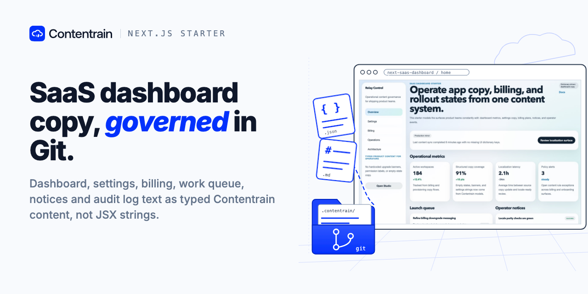

<p align="center"></p>

# Contentrain Next SaaS Dashboard

A Next.js (App Router) starter for the product surface of a SaaS app: the dashboard copy, settings screens, billing plans, work queue, operational notices and audit log all live in typed Contentrain models, not in JSX strings.

It shows how a team keeps product UI copy governed the same way as marketing content: every string an editor or an AI agent may change is a content entry with a schema, versioned in git next to the code.

## Use this template

Click **Use this template** on GitHub to create your own repository. To edit the content visually, connect the new repository in [Contentrain Studio](https://contentrain.io/studio): it reads `.contentrain/` as it is, and saves edits as commits.

## Quick start

```bash
pnpm install
pnpm dev        # http://localhost:3000
```

| Command | What it does |
|---|---|
| `pnpm dev` | Next.js dev server |
| `pnpm validate` | Checks models and content (`contentrain validate`) |
| `pnpm check` | Type check |
| `pnpm build` | Production build |
| `pnpm contentrain:generate` | Regenerates the typed client in `.contentrain/client/` after a model or content change |

## Pages

- `/`: overview, with stats, work queue, notices and recent audit events
- `/settings`: settings groups
- `/billing`: billing plans
- `/operations`: notices, queue and the full audit log
- `/architecture`: how the starter is put together

## Content model

Content lives in `.contentrain/` (models in `models/`, entries in `content/`). Pages read it in Server Components through the generated `#contentrain` client.

| Model | Kind | Domain | Used for |
|---|---|---|---|
| `site-settings` | singleton | system | Site name, tagline, theme, default locale |
| `navigation` | singleton | system | Sidebar items, announcement, call to action |
| `footer` | singleton | system | Footer blurb, link columns, legal notice |
| `seo-defaults` | singleton | system | Default meta title, description, canonical base, OG image |
| `dashboard-overview` | singleton | app | Overview heading, summary and primary action |
| `dashboard-stat` | collection | app | Stat cards (value, delta, trend) |
| `work-queue-item` | collection | app | Work queue rows (owner, priority, status, due) |
| `settings-group` | collection | app | Settings sections and their items |
| `billing-plan` | collection | app | Plans, prices, features, call to action |
| `ui-copy` | dictionary | app | Interface labels used across the shell |
| `ops-notice` | collection | ops | Operational notices with tone and action |
| `audit-event` | collection | ops | Audit log entries |

## Contentrain

Contentrain is a content governance ecosystem for teams and AI agents: content stays in your repository as typed JSON, with schemas, validation and git history. It has four parts: the open-source tools, Studio, Migrate and Bridge.

- Docs, CLI and SDK: [ai.contentrain.io](https://ai.contentrain.io)
- Next.js guide: [ai.contentrain.io/guides/frameworks#next-js-app-router](https://ai.contentrain.io/guides/frameworks#next-js-app-router)
- Studio: [contentrain.io/studio](https://contentrain.io/studio)
- Edit with an AI agent: [@contentrain/mcp](https://ai.contentrain.io/packages/mcp) locally, or [Studio MCP Cloud](https://docs.contentrain.io/developer/mcp-cloud) for teams
- Open-source tools (MIT): [github.com/Contentrain/ai](https://github.com/Contentrain/ai)
- Migrate, WordPress to Astro: [migrate.contentrain.io](https://migrate.contentrain.io)
- Bridge, a free WordPress plugin that exports content as a Contentrain store: [github.com/Contentrain/wordpress-bridge](https://github.com/Contentrain/wordpress-bridge)

## Deploy

`netlify.toml` builds with `pnpm deploy:netlify` on Node 22; leave the publish directory empty so Netlify's Next.js runtime handles it. Any host that runs Next.js works.

[](https://app.netlify.com/start/deploy?repository=https%3A%2F%2Fgithub.com%2FContentrain%2Fcontentrain-starter-next-saas-dashboard)

## License

MIT
